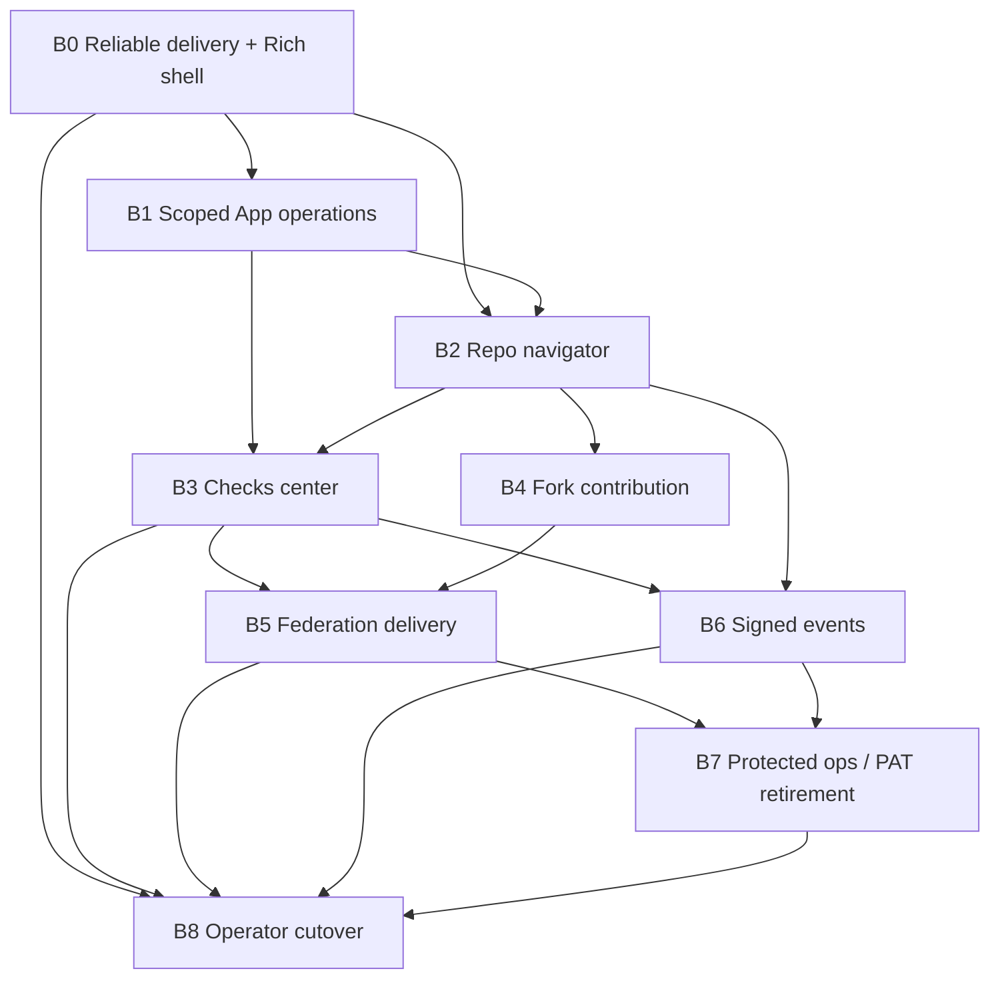

# Devtool — One integrated execution roadmap

**Roadmap:** `DEVTOOL-UNIFIED/1.0` · **Planning revision:** `1.8` · **As of:** 2026-11-25 UTC  
**Repository:** `Mikeyphw/devtool` · **Verified base main:** `093a6a927ca1438d9b30208fc9706c9326769868`  
**Status:** **W1/W2 MERGED; GA-00 P09 AND P17 RELEASE ACCEPTED / W3 FOUNDATIONAL SOURCE CANDIDATE**. It supersedes the **execution ordering and presentation** of the v1.1 Library design, **not** its original 24 overlay IDs, promise inventory, acceptance history, or Git commits.  
**Authoritative committed roadmap:** `docs/DEVTOOL_NATIVE_OVERLAY_DELIVERY_V3_ROADMAP.md` on `main` (historical milestone statuses may be stale). Revision 1.5 was adopted through merged PR #49. Revision 1.6 records the forward-only guide correction. Revision 1.7 recorded PR #52 and the pending P09 repair. Revision 1.8 reconciles the subsequent PR #53 merge and qualified protected release; introduces the W3 exact-archive, credential-scope and shared read-only CI gateway retry corrections and P16 selected-repository denial/restoration observer. See `docs/DEVTOOL_W3_FOUNDATIONAL_ACCEPTANCE.md` for per-promise evidence and remaining gates.  
**User operating contract:** `AGENT-OPERATIONS-DEVTOOL` v1.25, SHA-256 `850a858e863bb2715da7f9e09bd26ede3d7f81231f7da05db3b381b6cfb7df76` (read in full and byte-verified).  
**Canonical bug ledger:** `/Devtool/DEVTOOL_BUG_LEDGER_cg.md`, SHA-256 `f90e6a719b794ba86adad72c6b4675af6fa5901aa51dee6333f3b3e3e2782c32` (read in full; historical dispositions require current-source retriage).  
**Prior Library revision:** `DEVTOOL_UNIFIED_FINAL_ROADMAP_20261123_cg(1).md`, revision 1.1, SHA-256 `88ffd2c8636df386c15931f944da9429cac11379152a855e01a3c2043f6dfcaa`; this revision retains their complete promise wording and IDs in Appendix A.

> **Core change:** Do not deliver 'core', then 'GitHub App', then 'Rich UI' as three independent products. Each **vertical bundle** must expose one coherent user task through **one Devtool native engine**, **one operation-scoped App/credential boundary**, and **one shared Rich/operator interface** (with plain/JSON and optional Textual parity). This is sequencing and ownership reform, **not** permission to merge incomplete overlays or substitute UI mocks for production integration.

## Current execution waves and gates (supersedes historical queue)

| Wave | Work package | Dependencies | Mandatory exit evidence |
|---|---|---|---|
| W0 | Establish closure register and safe recovery | None | Exact authority/roadmap/repo/policy/installed operator hashes; full per-promise register; source/runtime/session/intent inventory; no unexpected changes |
| W1 | GA-03 / B3 production continuation and four core fixes | W0; applicable GA-00 operation gates | Existing session adoption, no replay; exact hosted GA-03 coverage, six required workflows, CI24, disposable App Checks readback; native transaction history; approved merge and main readback |
| W2 | B0 forward reconciliation and authoritative roadmap adoption | W0; integrate final W1 main | Preserve PR #49 and existing work, forward-only branch integration by approved native path, up-to-date registry/docs/schemas; native continuity tests, required CI and CI24; approved merge |
| W3 | B0/B1/B2 foundational acceptance (M0–M5, M7, GA-00/01/02; DT-RH01-F01) | W0; W1/W2 for final integrated source | Reuse exact historical receipts; run missing source, actual Termux and disposable App adverse tests; all relevant atomic promises qualified; recorded scope exceptions |
| W4 | M6 + RICH-U01/U02 combined remediation (RICH-U-C01) | W2; safe native/UI boundary established | Single Live/input owner, 35 M6 + 19 slice obligations, actual PTY/Termux, no-copy/exit/log behavior, docs/CLI parity, current-source required CI/CI24 |
| W5 | B4 safe fork lifecycle (GA-05) | W1–W3; shared host available | Actual disposable fork/upstream pair, source and owner locks, approved PR and CI, conflict/replay/denial negatives |
| W6 | B5 federation and shared libraries (M9 + GA-06) | W5; registry and native continuity | Provider plus two independent consumers, individual source/CI receipts and aggregate partial-failure handling; consumer compatibility |
| W7 | B6 trusted event continuation (M8 + GA-04) | W3; GA-03 evidence service | Genuine signed hosted callback, durable inbox/intent handling, offline recovery, no replay and no unapproved mutations |
| W8 | B7 protected operations (GA-07/08/09, GA-00 signing) | W3, W6, W7; owner policy | Scoped PAT equivalence before cutover; protected disposable signer proof, typed secret intents; deployment gate or approved equally strict fallback |
| W9 | B8 intelligence, ledger enforcement and adoption (GA-10/11, M5/M6) | W4–W8 | Canonical parser/help/schema/completions; native ledger gate; installed operator/CLI/JSON/Textual parity; actionable source-bound PR intelligence |
| W10 | Historical consumer/substrate reconciliation and final release | Starts read-only at W0; final gate after W9 | All still-applicable NEXT, G3R, FS03, consumer, device, distribution and security gates evidenced; independent release authority; signed artifacts and final source-bound closure receipt |

W1 accepted and merged. W2 adds exact PR #49 forward integration, single-owner signing approval profile, truthful session creation stage vs delivery state, and bounded PR negative reconciliation (DT-20261125-03). W3–W10 remain gated by their own evidence. P09 and P17 protected-release scope are accepted on PR #53 merged source; P16 installation selection, fresh W3 native/hosted qualification and physical Termux evidence remain separate.

## 1. The product we are actually building

From Termux/Ubuntu, a user selects an actual repository and checkout, sees a truthful read-only source/permission/session/CI snapshot, explicitly approves a bounded action, and gets the same reliable native Devtool transaction, GitHub delivery, exact required CI, separate CI24, and resumable receipt. The Rich interface is merely a **projection and control surface** over the canonical Devtool service; it never issues its own tokens, Git requests, commits, API requests, hidden CI polls or state journal.

**One operator:** the existing `devop-devtool_cg.pyz` line, installed/upgraded as one `~/.local/bin/devop-devtool`, is the cumulative roadmap-level entry point. Its offered verbs must be checked against the **real** installed operator/Devtool parser; this document does not assert unavailable commands are implemented. No additional per-overlay operator, separate CI engine, Live host, authorization service, App client, session journal or source-of-truth cache.

**Every bundle is a complete user journey:** discover/inspect → verify actor, repository and source SHA → confirm action and scope → execute **through native Devtool** → observe live result → recover unknown outcomes → record source-bound acceptance. Each journey is delivered with one vertical operator screen and machine-readable parity, not a back-end-only milestone followed by deferred UI work.

### Non-negotiable boundaries

- **Identity:** user-visible, App-installed, enrolled-by-policy and locally checked-out repositories are distinct; matching slug/alias alone never grants authority. Actual numeric repository/owner/installation ID and live grant required before privileged use.
- **Native ownership:** M3 owns atomic source mutations and session continuity; M4 owns GitHub push, PR and hosted CI; M7 owns credential diagnosis; M8 owns signed-event/durable-intent control; M9 owns federation graph/lock. GA overlays extend those owners, never duplicate them.
- **Evidence:** GitHub Actions green ≠ Devtool-native receipt; required six-workflow CI ≠ separately dispatched 24-shard CI24 ≠ successful live App permission tests ≠ protected signing/release. Each retains a separate gate and exact HEAD/run/attempt/artifact identity.
- **Preservation:** old Git worktrees, commits, dirty changes, PRs, source-bound transactions, confirmed/unknown remote intents and XDG/legacy state roots must be reconciled before replay. The deliberate loss of earlier XDG history is not proof that work never occurred.
- **Safety:** no local Gradle directly or indirectly, no force/rebase/reset/auto-merge, no implicit App installation/secret/ruleset/PAT revocation, no simulated proof, no automatic clipboard use, no secrets in argv/logs/receipt.
- **TTY:** foreground Devtool/`gh` with original stdout/stderr, exit code, Rich colors and signal handling; one `Live` and keyboard owner, restored terminal on all exits, plain/JSON/Textual available.

## 2. Source reality and progress — verified 2026-11-25

13/24 original overlay labels are merged: M0–M8 and GA-00–GA-03. This is merged-source coverage, not full independent acceptance. GA-03 PR #51 merge `9afd3368e19eb6f18f180a765de596e00463a8fb`, tree `b15c5435662ddfaf87e0f957a8b691679deda4dd`; W1 source `a86456137c83622679a85c43f4e65d747b51c88c`, required CI 6/6, CI24 24/24 (run 45634363584 attempt 1), Q01 live sandbox checks separately qualified. GA-01 PR #46 and GA-02 PR #48 were merged; historical receipt coverage remains source-bound. Remaining original acceptance counts INCONCLUSIVE. B0 PR #49 merged at `fecbe4696e4b32f07b6fca35ebe5646733d74df8`, tree `7b5f87068e061dd81d972592fbf68b20f83fe542`. W2 source `4652ae83f4c1db8ebdd739ed2f0f2050648e98ba` passed the six required workflows but failed CI24 run 45672206599 attempt 1 (23/24 shards successful; shard 6 guide-parity test failed; aggregation failed). Preserve the merged native session and PR history. Forward guide repair PR #52 merged at `75ccb2e85095b037d7fd77ad0cc3e165fe83ddd7`, tree `1bb740c83f3500c3976b71df6ef6a8045de91bbf`. Exact repair source `e2515427300d8e17d3ce71907c3edab20f7aab49` passed required CI 6/6 and CI24 24/24 (run 45685239528 attempt 1; 9550 tests, 762 modules). Owner verified the single-owner environment and registered a durable LIFE signer; actual ACTIONS-09 preview failed with `SINGLE_OWNER_REVIEWER_IDENTITY_NOT_PROVEN` because repository normalization dropped the owner. PR #53 repaired that projection, merged at `093a6a927ca1438d9b30208fc9706c9326769868`, tree `707f0b8ca6aeefa90c8b6c77738ceab42867794c`. Exact repair source `d9bcf8ceda0b267004373fa5e662741cd4f6913b` passed six required checks and CI24 run 45710436477 attempt 1 (24 shards plus summary, 9575 tests). Owner-side setup and readiness verified all eight configuration gates; signed release run 45713177754 attempt 1, artifact 15068442281, native qualification `ec82519ba2d24e65bc2830ba1bf735e7` independently verified owner approval, APK certificate and SLSA provenance. P09 and the P17 release-specific gate are accepted on that source/run/artifact. Full P17 live-App/native acceptance and P16 installation-selection denial remain incomplete. No new source is qualified by the historical release.

## 3. Integrated delivery batches — new order, **no new overlays**

**B0–B8 are work-bundle labels, NOT overlay IDs, Git branches, new milestones or acceptance shortcuts.** An original overlay may participate in multiple bundles; it is only accepted after its own entire promise matrix passes. Every active bundle must have a *single* product outcome, source owner, Rich view, negative campaign and exact acceptance receipt.

| Batch | User-visible end-to-end capability | Native Core / lifecycle | GitHub App, registry, governance | Rich UI from the same batch | Status / unlock |
|---|---|---|---|---|---|
| **B0 · Reliable source-to-PR workspace** | Recover committed work and show **exact** source, approved push, existing PR, required CI and separate CI24 | **M2–M5**, M6, DT-12/13/14/15 and base-drift repair | **GA-00, GA-01, GA-02** existing source/pins and PRs | **RICH-U01/U02** shared host/status, verified `PR_PENDING` vs `PR_VERIFIED`, log/exit/TTY parity | **NOW**. Source work and native recovery before further protected writes |
| **B1 · Scoped identity & credential console** | Select installation and one allowed operation, see exact effective permission and refusal reason | **M4/M7**, M6 | **GA-00/GA-01** App transport, M8 managed PATCH/PUT; no PAT fallback | App doctor, owner/install role and permission drilldown, consent/denial | GA-01 source partly built; live adversarial verification needed |
| **B2 · Repository navigator & relationship graph** | Browse account-visible, App-enrolled and local repos without confusing visibility with grants; select a checkout/fork | **M7**, M9 read-only locks, M6 | **GA-02**, GA-11 incremental discovery and policy edges | Responsive searchable repository/worktree picker, fork/alias provenance | GA-02 source partly built; real install/negative tests needed |
| **B3 · Evidence & Checks center** | Follow exact run/attempt, errors, artifacts, source and App Check Runs with truthful UI | **M4/M6/M8** read-only observer, shared log/keyboard | **GA-03**, GA-11 projection, GA-01 scoped Checks | One Live CI/Checks dashboard, run detail/pagination, no guessed success | Requires B0 CI observer, B1 read grants and B2 identities |
| **B4 · Safe fork contribution** | Inspect upstream/fork divergence; explicitly approve isolated branch/PR or refuse protected changes | **M3/M4**, M9 source locks, M6 | **GA-05**, GA-02 canonical fork ancestry | Divergence/protected-branch comparison, decision/recovery view | Requires verified B1/B2 identities and native intents |
| **B5 · Dependency-aware delivery** | Plan provider→2 consumers, simulate impact, deliver approved repos separately with exact CI | **M9/M3/M4/M6** DAG + per-repo journals | **GA-06**, GA-03 evidence, GA-05 forks | Per-repo dependency board, mixed success/blocker receipts | Requires B2/B3, B4 for fork writes; no fake atomic rollback |
| **B6 · Trusted events & continuity** | Verify webhook, queue a bounded approved intent, recover crash/disconnect without duplicate mutation | **M8/M7/M6** | **GA-04**, GA-02 install change + GA-03 check events | Event timeline, dedup/unknown states, safe explicit resume | Requires B1/B2/B3 as write preconditions; read UI can be built earlier |
| **B7 · Protected operations & credential transition** | Signed release/deployment gates, scoped secret/permission doctor, opt-in PAT retirement | **M4/M7/M8/M6** | **GA-08/GA-09/GA-07**, GA-00 security, GA-06 write equivalence | Protected action preview, signer evidence, scope diff, rollback | Separate risky approvals; not a prerequisite for unrelated read-only bundles |
| **B8 · Intelligence & operator cutover** | Unified daily operator workflow, source/security intelligence, complete mobile UX | **M5/M6**, RICH-U01/U02 | **GA-10/GA-11** and all accepted earlier backends | Rich primary when parity proven; Textual optional; plain/JSON complete | Final end-to-end parity, exact device, source and downstream receipts |

### Batch completion promises (each is a vertical definition of done)

**B0 — first, with GA-01/02 closure intertwined.** Read verified original sessions and worktrees. Implement *native* (not JSON edits) upstream-base reconciliation inside M3/M4's existing durable journal, requiring old-base ancestor→new-base and current exact PR/head/base and one atomic integrity-protected event recording old/new pin; refuse nonancestor, moved repo, wrong PR, unknown state, changed origin, duplicate attempts and unresolved intents. Record existing PR #48 **without POST**, then run one source-bound required-CI qualification and separately authorized CI24 via the native controller. Independently inspect GA-01 PR #46 source/CI/CI24 and finish source-backed integration. Render a truthful Rich read-only session and policy status with the exact same data as JSON/plain. Release blocking action: any unverified source/permission/CI/CI24 when its contract requires it. **Do not merge #46/#48 until independent per-overlay gates and explicit owner merge authorization.**

**B1 — authentication really works.** Verify real installed App on disposable owned repository, selected vs all repos, base vs fork role, scoped token refresh, redirect/unknown outcome, exact effective push URL and Git rewrite/AskPass boundaries. Preserve GA-01's native managed PR `PATCH` and labels `PUT` integration; test production preimage/postimage, durable intent and refusal on wrong repo. Rich Doctor must show only nonsecret capability conclusions and actual failures; no automatic installer or scope escalation.

**B2 — catalog never becomes authority.** Read-only account, App and local sources are separate and labeled; numeric IDs, selected installations, parent forks and explicitly enrolled relation edges are source-attested. Alias/rename/recreation/deleted/private/cross-host/dirty/untrusted-origin/cached-stale negatives verified. One Rich picker chooses the exact branch/worktree, but action preflight still re-probes installation, policy, source SHA and effective permission. M9 consumes source graph read-only before any cross-repo mutation.

**B3 — evidence cannot self-certify.** Source validation, integration and federation Check Runs have independent names, exact repo ID/SHA/session/attempt, bounded annotations and idempotent POST handling. Required Actions CI remains independent; each result includes exact run/attempt/job/artifact and separate CI24 24 shards + summary where required. Monitor has one native polling authority, one input owner, bounded original logs, truthful awaiting state and no automatic clipboard.

**B4 — fork mutations are deliberate.** Real disposable upstream/fork tests: compare divergence and protections, create source-bound intent, verify installation and ownership, approve one scoped nonforce operation, reobserve source/PR, fail on conflict, wrong installation or ambiguous outcome; render the proposal before execution, with no implicit force, reset, rebase, auto-merge or unsolicited PR.

**B5 — federation has per-repository truth.** Preserve MMRL N05F provider→two consumers behavior until equivalent; lock versioned repo and dependency identities; verify independent App install, native session, PR, required CI and CI24 per consumer where contract requires. Visualize `WAITING/BLOCKED/UNKNOWN_REMOTE` per node and retain partial failure; no global green or cross-repo atomicity claim.

**B6 — event continuity is recoverable.** Signed GitHub webhook HMAC verification at the external ingress, replay/duplicate/out-of-order/installation-change protections, durable queue, bounded approved actions via existing M8 intents, actual downtime/restart and no token leak. Termux polling fallback stays possible, without treating local phone as mandatory public listener. Rich event inspector is observational until each approved action goes through native controllers.

**B7 — sensitive work stays independently gated.** Split into three **sub-lanes, not new overlay IDs**: **B7-SIGN / GA-08** starts after GA-00/GA-01 secret-transport security and independently qualifies per-secret durable intent, typed LIFE refs and actual protected signer; **B7-DEPLOY / GA-09** requires B3 Checks + B6 trusted event path + B7-SIGN, with hosted protected deployment or strict explicit fallback; **B7-CUTOVER / GA-07** requires B5 real App write equivalence and verified consumer CI before optional owner-approved PAT retirement/rollback. These do **not** form a single artificial dependency chain. Do not couple unrelated B2/B3 read-only functionality to protected release gates. Rich shows evidence and owner-approved action impact, never secrets.

**B8 — operator cutover is a compatibility event.** GA-11 imports only the canonical views; remove duplicate UI logic and stale tests/docs, keep source event history, and validate Rich 28/32/36/40/48/60/80/100/120 columns, resize, zsh/tmux/SSH, Ctrl-C/termios, Q/A controls, log pagination, plain/JSON output, Textual opt-in, clipboard opt-in, direct executable zipapp with shebang. Default Rich switch only after real device parity and rollback path are verified.

### Dependency graph (authorization/acceptance, not arbitrary source-coding order)

Read-only discovery, Rich presentation and negative-test implementation may run **in parallel** before a protected-write dependency is accepted; source must not be promoted to executable privilege merely because its UI is ready. The initial B0/B1/B2 acceptance gates are ordered by their real write/identity dependencies, **not** because separate teams need to wait for every screen.

## 4. One stable overlay registry — all IDs, names, implementation and acceptance

| Original ID | Original full name | Integrated bundle(s) | Source implementation as verified | Independent remaining acceptance / risk |
|---|---|---|---|---|
| `M0` | Source audit and contract baseline | B0 | MERGED_SOURCE | Original receipts not reaudited |
| `M1` | Versioned declarative manifest contract | B0 | MERGED_SOURCE | Legacy/v3 negative tests need exact receipts |
| `M2` | Verified runtime and preflight parity | B0 | MERGED_SOURCE | Real Termux runtime parity not qualified |
| `M3` | Atomic apply, commit and post-commit session continuity | B0 | MERGED_SOURCE; REPAIR | Committed vs uncommitted failure, root/recovery proof |
| `M4` | Explicit remote push/PR and exact hosted CI qualification | B0/B3 | MERGED_SOURCE; REPAIR | GA-02 base pin and CI24 native receipts |
| `M5` | Migration, UX and launcher-optional cutover | B0/B8 | MERGED_SOURCE; REPAIR | Foreground TTY, exit, installer, native parity |
| `M6` | Termux-first vertical Rich Live console (overlay + GitHub Actions CI) | B0–B8 | MERGED_SOURCE; UX DEBT | Shared Live ownership and real mobile terminal tests |
| `M7` | Credential Doctor, installation repair and permission drift | B1/B2/B7 | MERGED_SOURCE | Real grants/revocation, fork and credential drift |
| `M8` | Event-driven continuation and bot-owned PR maintenance | B3/B6 | MERGED_SOURCE | Real signed ingress and crash recovery |
| `M9` | Cross-repository federation and dependency delivery | B2/B5 | PARTIAL | Read-only graph then two real consumer integrations |
| `GA-00` | Security and evidence baseline (release blocker) | B0/B1/B7 | MERGED_SOURCE | 17-promise/security/CI24/signing acceptance debt |
| `GA-01` | One capability-aware App authentication transport | B0/B1 | MERGED_SOURCE | PATCH/PUT source present; live App hostile tests + CI24 |
| `GA-02` | Installation, fork and relationship registry | B0/B2 | MERGED_SOURCE | Native session recovery, live account/install tests + CI24 |
| `GA-03` | App-native Checks and PR evidence | B3 | MERGED_SOURCE | W1 production CI24 and Q01 sandbox verified; other shared gates separate |
| `GA-04` | Webhooks, queued actions and installations | B6 | PLANNED | Hosted signed callback + durable queue |
| `GA-05` | Fork lifecycle and upstream contributions | B4 | PLANNED | Disposable fork, protected denied cases |
| `GA-06` | Shared-library propagation and cross-repository compatibility | B5 | PLANNED | Provider + two consumers and independent CI |
| `GA-07` | PAT retirement for selected cross-repository paths | B7 | PLANNED | Only after App equivalence and owner-approved rollback |
| `GA-08` | LIFE Secrets and protected signing | B7 | PLANNED | Actual protected signer + per-secret durable intents |
| `GA-09` | LIFE as custom deployment protection (feature-flagged) | B7 | PLANNED | Hosted protected deployment or explicit nonweakened fallback |
| `GA-10` | Security and PR intelligence (optional) | B8 | PLANNED | Source-anchored read-only intelligence before approved writes |
| `GA-11` | Operator experience and full adoption | B2–B8 | PLANNED / INTEGRATE | Native CLI/JSON/Rich full parity |
| `RICH-U01` | Shared inline Rich host and always-vertical M6 projection | B0–B8 | WIP / UNQUALIFIED | One host, widths 28–120, responsive terminal |
| `RICH-U02` | Delivery monitor Live ownership and POSIX keyboard extraction | B0–B8 | WIP / UNQUALIFIED | One input owner, key paths, signal/termios recovery |

**Remaining independent acceptance inventory: all 24 IDs above.** This means *unqualified or not fully reaudited*, not that merged-source functionality is absent. At each native batch, recheck individual promise rows and produce source-complete and accepted denominators after actual audit; no percentages fabricated from green workflows alone.

## 5. Acceptance operating contract for every batch

| Gate | Owner / what it proves | Promote only on actual evidence |
|---|---|---|
| **S0 — source and roadmap** | Exact original repo/ref/HEAD/tree, clean scoped worktree, current repository and source manifest, preserved native history, canonical bug ledger and full per-promise audit | Read-only source inspect, validator, preimage/hashes, no hidden dirty-state changes |
| **S1 — production & adversarial source** | Actual service/API/CLI/callback integration and restart/unknown-outcome negatives, real updated test plan | Existing and new production-path tests; count executed cases, never mocks-only as end-to-end |
| **N — Devtool native** | Native check/apply/validate/commit/session and integrated source/head continuity; zero direct/indirect local Gradle | Native transaction ID, history ID, source/tree SHA, original stdout/stderr and exit |
| **R — GitHub remote** | Push exact branch, existing/new PR source match, independently observed base/head; no duplicate POST | Native journal PR/remote receipt + live API read, no assumption from open GitHub PR alone |
| **C — required hosted CI** | Exactly six required workflows from committed policy on exact source SHA, run ID and attempt, registrar and evidence lineage | Native `REQUIRED_CHECKS_PASSED` receipt and independent GitHub successes, not just cached green |
| **C24 — CI24** | Separately authorized `workflow_dispatch` request, exact source/run/attempt, all **24 shards and summary**, independently verified artifacts | Qualifying saved native request/receipt; remote success alone is insufficient |
| **A — actual App/security** | Genuine disposable owner/repo/install grants, operations read/write, denied/private/wrong-fork/expiring credentials, nonsecret proof | Live effective scope + specific expected mutation, postimage and revocation negatives; never inferred from token mint |
| **U — real terminal/UI** | Rich shared host, callbacks, pager/input, narrow Termux/zsh/tmux/SSH and fallback parity | PTY/device logs/screens, expected/observed key routes, original logs and exit behavior |
| **G — shared governance** | GA-00, ruleset, protected signer/LIFE, deployment support, explicit secret/merge/release approval | Separate gate at its actual sensitive action boundary, no false 'global blocked' on read-only work |

Use `PLANNED|READY|PARTIAL|SOURCE_COMPLETE` separately from `NOT_RUN|NATIVE_VALIDATED|PR_DELIVERED|MERGED`, and `PENDING|PARTIALLY_VERIFIED|ACCEPTED|FAILED`. **No overlay is ACCEPTED unless every original relevant promise is independently verified across applicable S/N/R/C/C24/A/U/G evidence.** Mark unavailable device or App access as `PENDING_ENVIRONMENT` rather than replacing it with a mock or broad denial.

**Roadmap-level orchestration:** one cumulative `devop-devtool` CLI and preferred one-shot, resumable `overlay <ID> run` when actually implemented, through preflight → source check → native apply/commit/session adoption → existing/new PR observation → exact required CI → separately approved CI24 → watch/artifacts → receipts. Preserve original stdout/stderr, real exit status, safe explicit clipboard contract. Native checks cannot trigger Gradle through hidden hooks; inspect manifests first. Resume original state rather than replay after crash/uncertainty. Recheck GitHub, local worktree, library contract and bug ledger before every overlay.

### Shared governance ledger — deferred with enforcement boundary

| Gate | Current evidence status | Enforce before | Owner / safe next action |
|---|---|---|---|
| `GOV-SEC` | GA-00 merged source; 17 atomics and real App redirect/scoped security incomplete | App privileged writes/security acceptance | Reaudit GA-00 production and real hostile App scenarios; no credential leakage |
| `GOV-CI24` | No independently qualified current-HEAD GA-01/GA-02 CI24 receipt | Corresponding overlay acceptance, and merge if configured as required | Native source-bound dispatch/reconcile, exact 24-shard+summary/artifact evidence |
| `GOV-RULESET` | Committed six-workflow policy stricter than historical enforcement rule; live governance current may drift | Protected merge/policy assertion | Owner-approved ruleset comparison, readback; no silent mutation |
| `GOV-SIGN` | Signing and LIFE scope not qualified by this plan | Protected signing, release, deployment and secrets mutation | GA-08/09 + GA-00 actual signer/environment approval |
| `GOV-DEVICE` | This plan did not execute on Termux/device | Default Rich cutover and claimed Android release/device acceptance | PTY/device real captures and native receipts |

## 6. Historical 2026-11-24 execution queue (superseded by current waves below)

1. **B0 native continuity FIRST:** inspect original GA-02 session `686c...` and GA-01's actual session before any change; reject stale/dirty target, reconcile old pin `44f48e...` → current main `05e120...` through a tested integrity-protected **native** journal update retaining old pin/audit event. Observe existing PR #48 without new PR POST. Include tests for unrelated/diverged main, source drift, unresolved intents, duplicate PR, unknown API outcome and retained prior push proof. Carry applicable DT-12/13/14/15/17/18 and current open ledger defects into the actual eligible integrated repair batch after source retriage.
2. **GA-01 B1 closure:** don't reimplement already-present PR PATCH/PUT; inspect all callers and GA-00 security 17 promises; run full source tests and disposable actual App scope/forbidden-operation campaign. Qualify PR #46 through its own native existing-session PR and required CI/CI24 receipts; do not call successful hosted source tests sufficient.
3. **GA-02 B2 closure:** add both live-registry and federation guard suites to its production-focused validation list, alongside existing requirements; verify `live-catalog` and `qualify-operation` on current source with live private/fork and denied grants. Reuse real repo ID/owner/install pin + M7 credential doctor and preserve existing PR #48 delivery history. Requalify required CI and CI24 **if source changes**.
4. **Rich alongside, not after:** build the shared M6/RICH-U host and stable read-only session/doctor/registry surfaces in the **same B0–B2 batch pipeline**. Qualify 28–120-column/PTy, input/exit, actual stdout/stderr and JSON parity before promoting UI promises; don't block independently implementable GA source fixes on device UX acceptance.
5. **Only after B1/B2 acceptance**, promote B3 GA-03 protected Check Run implementation, then B4/B5 fork+federation; B6 signed events; B7 protected operations; B8 final cutover. Read-only source slices may be parallelized with separate identities and receipts.

**Exact current exit criteria for “close GA-01/02”:** complete per-promise code audit (including real production adapters), clean native source history, no unresolved intents, PR #46/#48 exact preserved identities, native delivery receipts `PR_VERIFIED`, source-bound `REQUIRED_CHECKS_PASSED`, independently qualified 24/24 CI24 including summary/artifact evidence where applicable, real scoped App permissions and adverse fork/owner/revoked/unknown writes with disposable targets, and GA-00 security gates enforced where a privileged path is claimed. Owner approval needed to merge PRs after gates; do not auto-merge or call GA-02’s earlier `PLANNED` delivery stage a failed native apply.

## 7. Implementation rules and ownership guardrails

- **One GitHub transport:** GA-01 provides operation admission on M4's scoped App issuer; M7 Doctor/Actions/Delivery/Federation consume the same provider. No duplicate REST client or silent PAT fallback. UI reads safe DTOs/receipts, not tokens.
- **One repository identity:** GA-02's installed observer + explicit relationship policy uses numeric IDs and role-aware installs. GA-11 contributes navigation, *not* authorization. M9 consumes immutable graph and locks, not names or view caches.
- **One native delivery authority:** M3/M4/M5 remain the only transaction/PR/CI24 source of truth; Rich and M8 are views/coordinators, never direct git/HTTP fallback execution engines.
- **One Rich terminal owner:** M6 `Live` and POSIX keyboard policy owns screen; U01/U02 are remaining original acceptance scopes and contribute shared components to B0–B8, not parallel UI products. Rich only displays evidence; colors are not statuses.
- **One source review unit:** a batch can be one cohesive PR, but previously qualified PRs/sessions retain their original identities. For GA-01/02 existing PRs, add source commits only when necessary, then rerun exact-head gates. Never fold unrelated work into these branches just to save PRs.
- **One operator:** use the existing `devop-devtool` cumulative zipapp and native Devtool lifecycle. No separate installer, subcommand alias or hidden auto-upgrade; don't claim planned command grammar is already live.
- **Audit bug ledger before each actual work batch:** repro/triage from `DEVTOOL_BUG_LEDGER_cg.md` is historical until checked against current exact branch. Fold verified defects into next eligible repair, defer with explicit cause when unsafe. Especially watch DT-12 (no-commit vs postcommit), DT-13 (mutable CI runs), DT-14 (state-root split), DT-15 (TTY), DT-17/18 (runtime/controller), DT-19–27 source-specific workflow/operator issues. Do not turn assistant Zsh pattern mistakes into Devtool defects.

## 8. Promotion and rollback rules

- **Design draft → repository authority:** Native docs-only source-pinned overlay against a clean current worktree with review; no direct edit of `main` and no implicit roadmap authority swap. Preserve former design/hash and reconcile actual repo roadmap before any next batch.
- **B0 recovery:** integrity-protected audit record retaining original pin, old/new base, source/PR/remote identities and check results; don't mutate journal manually; rollback is restore through native backup/recovery with zero silent reapply or duplicate remote write.
- **App/provider change:** feature flag or opt-in with independent old credential path preservation until verified equivalence; explicit owner-approved cross-installation tests; revert at source/worktree level only when native historical commitments allow.
- **Rich cutover:** preserve plain/JSON and Textual opt-in, fallback to prior renderer on verified device/TTY mismatch; never alter underlying operation state to hide UI regression.
- **CI and migration:** artifact/source HEAD changes invalidate prior qualifying CI evidence for a new head; CI24 run IDs and attempts never transferred across commits; old receipts preserved as historical.
- **Acceptance receipt:** per original overlay ID: promise → production entry/caller → negative test → native transaction/session → GitHub source PR + run/attempt → CI24 artifacts → real App/device if applicable → residual gate. Source presence and repository merge are not one-bit acceptance.

---

## Appendix A — preserved original outcome and atomic promise contracts (v1.1)

All original M0–M9, GA-00–GA-11 and RICH-U01/U02 **promise wording and IDs** below are inherited from the prior v1.1 roadmap (headings renested for readability); dated historical verdicts are **not** current accepted claims. This appendix is normative for original scope, while Sections 1–8 supersede earlier sequencing. There are **no new overlay IDs** and no dropped promise IDs.

### A.1 — Original overlay-level contracts

#### A.1.1 — Native M-series (preserve original semantics)

**M0 — Source audit and contract baseline.** Retain authoritative component inventory and exact source SHA/tree/blobs, existing tests, native transactional and CI/PR boundaries. Acceptance: source-bound map plus invariant-to-test matrix; no guessed merge/release.

**M1 — Versioned declarative manifest contract.** Optional v3 `delivery_contract` strictly parsed; never change existing ZIP/v1/v2, root `repository`/`inventory`/`validation`/`apply` semantics. Acceptance: positive/adversarial schema and old-manifest compatibility, refusal of unknown required capabilities.

**M2 — Verified runtime and preflight parity.** Trusted compatible runtime pinned by commit/tree/module/schema; independent target worktree and archive preverification; no PATH or symlink/source drift acceptance. Acceptance: tampered source, detached target, dirty tree, incompatible runtime and wrong origin fail before mutation.

**M3 — Atomic apply, commit and post-commit session continuity.** Reuse native transactions/validation; adopt committed session exactly once. Explicit failed-validation, committed-but-adoption-uncertain and precommit rollback states; canonical state roots. Acceptance: fault injection pre/during/postcommit, deterministic idempotent native resume, no duplicate commit or silently lost journal.

**M4 — Explicit remote push/PR and exact hosted CI qualification.** Operation-verified App/PAT/gh/SSH identity, explicit approvals, intent before remote mutation, exact head/base, draft PR by default, no force/rebase/auto-merge, read-only reconciliation after ambiguous POST. Exact required workflow/run/attempt/PR HEAD and policy. CI24 separate; no arbitrary green check counts as a release gate.

**M5 — Migration, UX and launcher-optional cutover.** Canonical native `check→apply→commit/adopt→deliver→ci` with ZIP/PYZ parity; preserve v3.2 launcher and old immutable artifact validity. Fix foreground child TTY/exit/signal fidelity, machine JSON purity, terminal/pager behavior; no hidden background delegate. Acceptance: attached real Termux and hosted tests, docs/schema/migrations current.

**M6 — Termux-first vertical Rich Live console (overlay + GitHub Actions CI).** Single inline shared Live host for overlay, CI and operator workspace; source-derived progress and liveness, bounded display events with durable logs, precise keyboard/log pagination, Nerd/Unicode/ASCII fallback, no false auth/CI statuses, restored terminal. Explicit Rich default only after parity; Textual remains selectable. **RICH-U01 and RICH-U02 are M6 remediation slices**, not independent display engines.

**M7 — Credential Doctor, installation repair and permission drift.** Reuse merged doctor for actual PAT/gh/SSH/App effective repository capabilities, base/head installations, missing selection, expiry/recreation drift; guided consent, never automatic escalation; predelete feasibility and postrecreate probe. Acceptance: synthetic and authorized live negatives, secret-free records.

**M8 — Event-driven continuation and bot-owned PR maintenance.** Reuse merged HMAC/dedup/inbox/approved finite intent policy; resume without duplicate POST/dispatch and fail closed on changed HEAD/install. GA-04 adds missing external event delivery, not another event engine. Acceptance: real webhook or bounded Termux fallback, replay/crash/unknown-outcome tests, independent live exact-source checks.

**M9 — Cross-repository federation and dependency delivery.** Frozen bounded DAG per numeric repo ID, source commit/tree, PR branch/base, each repo's installation/grants, native transactions/CI receipts, explicit mixed `WAITING/BLOCKED/UNKNOWN_REMOTE` outcomes. No cross-repository atomicity, rollback only within native uncommitted transaction. Acceptance: fork+denied installation, cycles, recreated ID, crash/partial failure, independent hosted CI for every child.

#### A.1.2 — GitHub App GA-series (retained complete outcome classes)

**GA-00 — Security and evidence baseline (release blocker).** Must close all 17 atomic security promises identified in §6 (effective push URL and rewrite guards, credential prompt host binding, no redirected token leak, release secret containment, durable secret intents, LIFE typed refs, governance previews/approval, tests/receipts). This security boundary cannot be declared accepted merely because GA-00 source was merged through PR #45.

**GA-01 — One capability-aware App authentication transport.** One central per-operation installation-scoped client with exact numeric repo identity; strict allowlisted read/write APIs and capability requirements; token lifetime/rotation without persistence; explicit `auto`/PAT/gh/SSH fallback semantics, never silent provider substitution; authenticated Git push via protected helper, no credential in URL/env/argv/log. Reuse M4 and M7. Acceptance: real scope matrix + adverse 401/403/404, wrong fork/install/owner, token substitution, redirect and unknown POST tests.

**GA-02 — Installation, fork and relationship registry.** `github_installations.py` and `github_relationships.py` own immutable repository/owner/installation ID observations, fork/public-base distinctions, explicit opt-in relationship edge provenance, live permission prewrite; adapt M9 discovery. Extend **within GA-02** to read-only user-owned/collaborator/organization repository catalog and local checkout/worktree association; never silently grant App access from user membership. Acceptance: rename/recreated ID, cross-owner fork, revoked installation, private/absent upstream, alias collisions, stale caches, unexpected local Git origins, safe source fetch refusal.

**GA-03 — App-native Checks and PR evidence.** Separate independently named Source Validation/Integration Qualification/Federation Compatibility Check Runs, idempotent per exact repo ID/SHA/check/session/attempt, bounded annotations and trusted evidence URL. Actions CI verifies its own runs independently; App check publisher may **never self-certify** that Actions passed. Acceptance: real disposable Check Run, mismatch/failure/stale attempt/duplicate negatives.

**GA-04 — Webhooks, queued actions and installations.** External trusted HTTPS adapter + durable ingress queue, not Termux-hosted mandatory public port; raw HMAC, delivery ID/install/repo binding, replay/dedup and out-of-order safety; handle installation, installation_repositories, repository, push, PR, Check Run/Suite, workflow and optional deployment events. Only enqueue bounded approved intents using M8. Acceptance: hosted signed callback, downtime recovery, flood/redirect/race/bot-loop tests, no implicit release/merge.

**GA-05 — Fork lifecycle and upstream contributions.** Read divergence and exact branch protection; plan owned fork update or upstream contribution with isolated branch, controlled fast-forward/conflict/cherry-pick proposals; approved draft PR via existing session authority; fail on ambiguous upstream/missing installation, no auto force/rebase/reset/merge. Acceptance: disposable diverged/fork pair with wrong owner/ref/PR duplication negatives.

**GA-06 — Shared-library propagation and cross-repository compatibility.** Generalize MMRL N05F provider+two-consumer sequence without deleting working N05F implementation until proven equivalence; explicit source ID/SHA and dependency mode, consumer-specific CI/PR/protected base and aggregation, independent partial outcomes. Reuse M9 scheduler/lock and native sessions. Acceptance: real source-pinned provider → two consumer plans/PRs, hosted each CI, failure and installed-token isolation.

**GA-07 — PAT retirement for selected cross-repository paths.** Optional, owner-approved opt-in migration: old PAT workflow remains valid until App route has read-only functional equivalence and approved real writes + actual consumer CI, then explicit revocation with rollback. Acceptance: no early cutover, no missing App permission, no hidden broadly scoped credential.

**GA-08 — LIFE Secrets and protected signing.** Typed secret bindings (repo ID, environment, local LIFE signer fingerprint, provider, purpose, intent, evidence); repository/environment encrypted upload through scope-specific endpoints; per-secret intent/unknown-response reconciliation, signer verified separately, release secrets absent from debug/untrusted contexts. Acceptance: real protected signing on disposable identity and complete partial-failure matrix.

**GA-09 — LIFE as custom deployment protection (feature-flagged).** Independent source/run/attempt/artifact/signer attestation on supported GitHub plans; event callback approval only after policy and human authority, not by CI green alone; if unsupported use explicit independent manual/CLI gate, never weaken requirements. Acceptance: hosted disposable deployment and wrong artifact/commit/event negatives.

**GA-10 — Security and PR intelligence (optional).** Read-only actionable source and CI/impact diagnosis first; authorized bounded comments/check annotations or SARIF after evidence validation, strict per-repo permissions, no unsolicited spam, no running malicious fork code as App. Acceptance: source annotations map to exact code/line and fail secure on secrets or malicious content.

**GA-11 — Operator experience and full adoption.** Canonical CLI + JSON schemas and a single shared M6 Rich host; presents App doctor/installations, registry/user catalog, fork plans, federation status, Checks, secrets, events, and source-bound workflows. User-facing command names are proposed until parser/help/schema/completions are implemented. Acceptance: Termux-first real end-to-end navigation and delivery walkthrough, plain/JSON equivalence, clipboard explicit only, Textual selectable, narrow widths and restored terminal on all exits.

#### A.1.3 — Rich-U exact owner slices

**RICH-U01 — Shared inline Rich host and always-vertical M6 projection.** Single `Live` owner; vertical layout at 28/32/36/40/48/60/80/100/120, no artificial width floors, correct terminal geometry/resize, log paging, bounded events/real progress, local Rich/TTY signals. Must not invent native validation or change source status based on presentation.

**RICH-U02 — Delivery monitor Live ownership and POSIX keyboard extraction.** Move CI monitor to shared host and extract keyboard/input owner; retain `j/k`, arrows, Enter details, `v`, `l`, `[`, `]`, `r`, `q` and source-bound explicit log GET. Restore termios on signal/exception/resize; avoid extra polling, CI status inference, or automatic clipboard.

**RICH-U-C01 combined deliverable (composite, not new overlay ID):** fold U01, U02, shared `operator_workspace.py` Live ownership, missing M6 Rich-default/Textual-opt-in CLI wiring, docs/fixtures and exact native/hosted/device acceptance into **one cohesive, source-bound remediation branch** after WIP reconciliation. The composite does not magically qualify both overlays: each retains its own promise matrix and receipt.

---

### A.2 — Historical promise traceability — non-negotiable repair checklist

This section retains every currently identified atomic **GA-00**, **M6**, **U01** and **U02** promise ID. Prior status is from the 2026-11-22 candidate audits, **not a new code/Termux run**. Re-audit each row against actual branch and current source before implementation and before qualification; `FULL` only after all relevant native/hosted/device gates.

#### A.2.1 — GA-00: 17 atomic promises

| ID | Promised behavior | Historical verdict / proof required |
|---|---|---|
| GA-00-P01 | Verify repository/source and actual App installation authorization | PARTIAL; live grant probe needed |
| GA-00-P02 | Verify exact effective push URL before credential exposure | MISSING; reject altered push destination |
| GA-00-P03 | Reject Git URL `pushInsteadOf`/rewrite redirect | MISSING; adversarial effective-URL test |
| GA-00-P04 | Bind AskPass/credential prompt to trusted host | MISSING; malicious prompt refused |
| GA-00-P05 | Token absent from argv, origin, unrelated children and logs | PARTIAL; runtime leak proof |
| GA-00-P06 | Reject authenticated API/Git redirects in privileged paths | UNVERIFIED; all adapters |
| GA-00-P07 | Debug workflows do not receive production signing env secrets | MISSING; hosted workflow isolation |
| GA-00-P08 | Unsigned/local signing variants cannot access hosted release secrets | MISSING; gated jobs |
| GA-00-P09 | Release signer uses approved protected environment when available | ACCEPTED on PR53 merge; actual environment-only provisioning, owner approval and signed release verified; subsequent source drift requires its own check |
| GA-00-P10 | Four secret writes have independent durable intents / reconciliation | MISSING; partial-failure recovery |
| GA-00-P11 | Metadata/name readiness distinct from cryptographic signer proof | PARTIAL; release readiness semantics |
| GA-00-P12 | LIFE secret provider refs strict types and allowlists | MISSING; serialization guard |
| GA-00-P13 | Secret-like injection prevented before storing receipt | PARTIAL; adversarial values |
| GA-00-P14 | Ruleset governance compared to committed six-workflow CI policy | PARTIAL; source-bound preview |
| GA-00-P15 | Governance change separately owner approved, diff and readback | MISSING; protected mutation plan |
| GA-00-P16 | Required GA-00 negative tests actually executed and passed | PARTIAL; previous real disposable negative/write campaign retained; selected-repository removal/restoration observer now implemented, live owner campaign pending |
| GA-00-P17 | Native + live App + hosted exact-source full receipts | PARTIAL; exact P09/P17 release scope accepted, full native/live-App matrix still independent |

#### A.2.2 — M6: 35 current audit obligations

| ID | Promised behavior | Historical state / mandatory proof |
|---|---|---|
| M6-01 | Overlay and CI share one Rich Live host | PARTIAL; single owner PTY |
| M6-02 | Operator workspace read-only view shares same terminal owner | PARTIAL; operator migration |
| M6-03 | Overlay presentation consumes canonical native apply/events | UNVERIFIED; native ZIP/PYZ |
| M6-04 | No duplicate GitHub/CI/apply engine | UNVERIFIED; end-to-end call graph |
| M6-05 | One column even at wide widths | PARTIAL; >=100 fixed and PTY |
| M6-06 | Compact repo/branch/source/runtime/artifact identity | PARTIAL; narrow PTY |
| M6-07 | Ordered actual stages and source-derived counters | UNVERIFIED; native events |
| M6-08 | Timestamped real events and bounded viewport | UNVERIFIED; journal match |
| M6-09 | Original native stdout/stderr remain visible | UNVERIFIED; foreground child |
| M6-10 | Durable logs separate from bounded display | UNVERIFIED; crash/restart |
| M6-11 | Determinate progress only with real completed/total | UNVERIFIED; real counter |
| M6-12 | No fabricated required CI or release success | UNVERIFIED; failed/skipped CI |
| M6-13 | CI observer uses same shared Rich, not second dashboard | PARTIAL; U02 live |
| M6-14 | Exact PR HEAD/workflow/run/attempt/job/step preserved | UNVERIFIED; authenticated evidence |
| M6-15 | Keyboard j/k/arrows/Enter/v retained | UNVERIFIED; real PTY |
| M6-16 | Explicit source-bound log GET and [`[`/`]`] paging | UNVERIFIED; real GET |
| M6-17 | Manual refresh preserves CI polling budget | UNVERIFIED; live poll count |
| M6-18 | Detach never cancels/reruns/falsely qualifies | UNVERIFIED; durable resume |
| M6-19 | App identity, installation/capability status visible | UNVERIFIED; current doctor comparison |
| M6-20 | Auth, operation approval, remote verification, CI are distinct | UNVERIFIED; negative state matrix |
| M6-21 | Fork/base access, expiry, drift visible | UNVERIFIED; real denied scenarios |
| M6-22 | Approval guidance, never implicit install or permission increase | PARTIAL; read-only guidance |
| M6-23 | Nerd/Unicode/ASCII icons with graceful fallback | UNVERIFIED; actual Termux |
| M6-24 | Unicode/emoji/grapheme display width safe | UNVERIFIED; 28–120 cols |
| M6-25 | Status discernible without color | UNVERIFIED; NO_COLOR |
| M6-26 | Inline `screen=False`, `transient=False`, no alt-screen | UNVERIFIED; shell prompt proof |
| M6-27 | Terminal restored on exception/SIGINT/resize | UNVERIFIED; termios matrix |
| M6-28 | Plain/non-TTY/JSON/CI behavior remains faithful | PARTIAL; CLI parity |
| M6-29 | No untrusted ANSI/markup or credential leakage | UNVERIFIED; adversarial provider payload |
| M6-30 | Clipboard only on explicit collection/copy | UNVERIFIED; negative no-copy |
| M6-31 | Test updates retain security and current-behavior invariants | PARTIAL; comprehensive suite |
| M6-32 | Termux portrait 40/60/80, SSH/tmux and resize | UNVERIFIED; device receipts |
| M6-33 | ZIP/PYZ native check/apply/commit/session plus CI | UNVERIFIED; source-bound end-to-end |
| M6-34 | Rich primary default, Textual explicitly selectable | MISSING; CLI cutover |
| M6-35 | Canonical docs/CLI/schema/workflow filters up to date | PARTIAL; regen + CI |

#### A.2.3 — RICH-U01 and RICH-U02: preserve all 19 slice promises

| ID | Exact slice requirement | Prior status |
|---|---|---|
| U01-P01 | Extract shared inline Rich Live host | PARTIAL |
| U01-P02 | OverlayLiveProjection uses shared host | PARTIAL |
| U01-P03 | Always-vertical 28–120-column layout | PARTIAL |
| U01-P04 | Remove width floor; live geometry/resize | PARTIAL |
| U01-P05 | Focus/log paging survives all widths | PARTIAL |
| U01-P06 | Keep Textual selectable | UNVERIFIED |
| U01-P07 | Presentation cannot mutate verdict/clipboard | UNVERIFIED |
| U01-P08 | Source changes through native apply/commit/session | MISSING |
| U01-P09 | Full integration, hosted, Termux/device tests | PARTIAL |
| U02-P01 | Delivery monitor uses shared Live host | UNVERIFIED |
| U02-P02 | POSIX keyboard extracted to shared input module | UNVERIFIED |
| U02-P03 | Preserve all CI keyboard controls | UNVERIFIED |
| U02-P04 | Explicit source-bound logs/pagination | UNVERIFIED |
| U02-P05 | CI poll/detach/verdict remain native-owned | UNVERIFIED |
| U02-P06 | Restore TTY on all failure/signal/resize paths | UNVERIFIED |
| U02-P07 | Exact-source preflight and idempotent retry | PARTIAL |
| U02-P08 | Atomic operation/recovery under Devtool lifecycle | MISSING |
| U02-P09 | Focused tests and real PTY evidence | UNVERIFIED |
| U02-P10 | Preserve Textual/JSON/plain/clipboard/release boundaries | UNVERIFIED |

---

## Appendix B — immutable provenance and current verification limits

- Parent Library v1.1 source SHA-256: `88ffd2c8636df386c15931f944da9429cac11379152a855e01a3c2043f6dfcaa`; preserved as separate user file and never overwritten by v1.2.
- Contract v1.15 SHA-256: `cb3963ba70dd90001d04b07eb11c12cb6f29fad3d9de5fb19dda3952e1596100`.
- Canonical bug ledger SHA-256: `397af7992d5e23d2afd4f5f0f8c918ce1f7d6acd1ee7eecc1fa438c0bcae18c3`.
- Verified GitHub `main`: `05e120d185ce8e81287b591bac6a221054abe94e` and merged-source repo baseline; PR #46 `f4290fb...` draft, PR #48 `b6e6550...` draft (observed 2026-11-24 UTC). Both on `main` as branch ancestor (behind 0); PR #48 also includes GA-01 head as ancestor. GitHub Actions required 6/6 and GA source steps observed successful on exact heads, but independent native CI24 and real App acceptance missing.
- Authority boundary: this document is a **design artifact** prepared externally; no exact Termux Git worktree, installed interpreter/launcher, native overlay check/apply/commit, GitHub write, CI24 dispatch, real App installation, device test, or roadmap Git adoption was performed by generating it.
- Next gate: source-bound native review and adoption of this v1.2 roadmap through the ONE cumulative Devtool operator, then B0 receipt and actual GA-01/02 closure. Never turn this plan into a 'verified applied overlay' merely because its Markdown integrity is valid.
